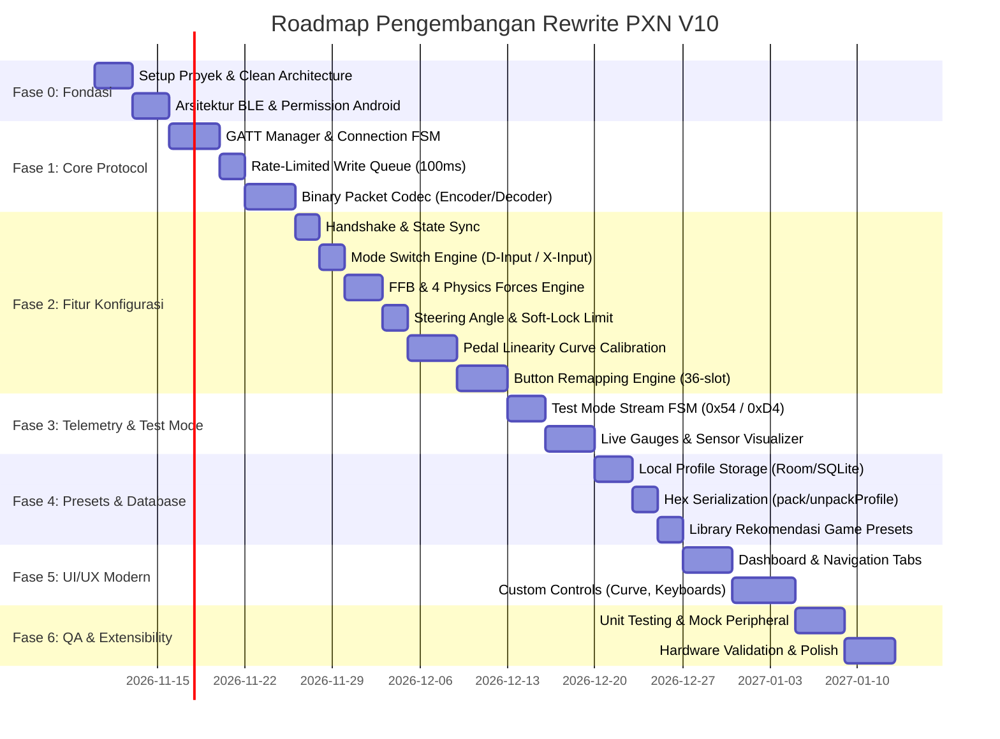

# DEVELOPMENT TASK ROADMAP & IMPLEMENTATION SPECIFICATION
## PXN V10 Companion Application - Rewrite & Extensibility Blueprint

---

## 1. Pendahuluan & Strategi Eksekusi

Dokumen ini adalah **Master Task List & Development Roadmap** untuk memandu rekayasa ulang (*rewrite*) aplikasi pendamping kemudi **PXN V10 Force Feedback**. 

### Prinsip Utama Pengembangan:
1. **Zero Functionality Loss**: Setiap frame biner, state machine, dan logika hardware yang ada di basis kode lama (`v1.5.4`) harus direplikasi 100% tanpa deviasi perilaku.
2. **Decoupled Architecture**: Memisahkan lapisan protokol biner murni dari UI framework, sehingga logika inti (*Core Domain & BLE Protocol Engine*) dapat diuji secara otomatis dan mudah di-porting ke platform lain (Android, iOS, Desktop/Windows).
3. **Hardware Extensibility**: Struktur kode dirancang dengan interface abstrak sehingga memudahkan penambahan dukungan kemudi PXN tipe lain (V9, V99, V12, V12 Lite) di masa depan tanpa merusak modul V10.

---

## 2. Struktur Milestone & Timeline Fase



---

## 3. Rincian Task per Fase

---

### FASE 0: SETUP PROYEK & FONDASI ARSITEKTUR

#### Task 0.1: Setup Proyek & Clean Architecture Layering
- [ ] Inisialisasi proyek baru dengan modul terpisah:
  - `:core:ble` (Manajemen Bluetooth Low Energy murni, agnostik UI)
  - `:core:protocol` (Codec biner request/response PXN V10)
  - `:core:model` (Domain models: `V10DeviceState`, `V10Profile`, `TestData`)
  - `:core:database` (Penyimpanan profile lokal via Room / SQLite)
  - `:feature:dashboard` (Layar kontrol utama kemudi, pedal, shifter)
  - `:feature:testmode` (Layar uji live telemetry sensor)
  - `:feature:profiles` (Layar manajemen preset per game)
- [ ] Setup Dependency Injection (Hilt / Koin).
- [ ] Konfigurasi Kotlin Coroutines & Flow (atau RxJava3) untuk arsitektur reaktif non-blocking.

#### Task 0.2: Modern BLE Permissions & Android 12+ / 13+ Compliance
- [ ] Implementasi runtime permission handler:
  - `android.permission.BLUETOOTH_SCAN` (dengan flag `neverForLocation` jika lokasi GPS tidak diperlukan).
  - `android.permission.BLUETOOTH_CONNECT`.
  - Fallback ke `ACCESS_FINE_LOCATION` dan `BLUETOOTH_ADMIN` untuk Android 11 ke bawah.
- [ ] Implementasi pengecekan status Bluetooth adaptor (Aktif / Nonaktif) dengan prompt pengaktifan otomatis.

---

### FASE 1: PROTOKOL BINER & CORE BLE ENGINE (`:core:ble` & `:core:protocol`)

#### Task 1.1: BLE Scanner & Peripheral Filter
- [ ] Buat scanner berbasis `BluetoothLeScannerCompat` (Nordic Library) atau API native.
- [ ] Filter pemindaian hanya mendeteksi perangkat dengan Advertised Name:
  - Target: `"PXN-V10"` (Case-Insensitive matching).
- [ ] Expose `StateFlow<ScanStatus>` ke UI (Scanning, DeviceFound, Stopped).

#### Task 1.2: GATT Connection Lifecycle & FSM
- [ ] Bangun Finite State Machine (FSM) status koneksi:
  `DISCONNECTED` -> `CONNECTING` -> `CONNECTED` -> `DISCOVERING_SERVICES` -> `INITIALIZING_NOTIFY` -> `READY`.
- [ ] Hubungkan ke GATT Service UUID: `0000ffe0-0000-1000-8000-00805f9b34fb`.
- [ ] Ambil Characteristic Write UUID: `0000ffe1-0000-1000-8000-00805f9b34fb`.
- [ ] Ambil Characteristic Notify UUID: `0000ffe2-0000-1000-8000-00805f9b34fb`.
- [ ] Tulis ke Client Characteristic Configuration Descriptor (CCCD `00002902-...`) nilai `ENABLE_NOTIFICATION_VALUE` (`0x01, 0x00`).
- [ ] Implementasi auto-reconnect logic jika koneksi terputus tiba-tiba (*GATT 133 / Link Loss*).

#### Task 1.3: Rate-Limited Write Queue (100ms Pacing & Deduplication)
- [ ] **Masalah**: Setir V10 akan *drop packet* jika menerima kiriman data lebih cepat dari 100 ms.
- [ ] Buat antrean thread-safe `PriorityBlockingQueue` atau Channel Coroutine dengan interval timer **100 ms**.
- [ ] **Packet Deduplication / Replacement**:
  - Jika pengguna menggeser slider FFB dari 50 -> 60 -> 70 -> 80 dengan sangat cepat, paket FFB lama yang masih berada di antrean harus digantikan oleh paket terbaru (`70` atau `80`) agar antrean tidak macet.
- [ ] Callback sinkronisasi: Tunggu `onCharacteristicWrite` sebelum memicu paket berikutnya dari antrean.

#### Task 1.4: Inbound Packet Router & Stream Parser
- [ ] Tangkap payload byte mentah dari `onCharacteristicChanged`.
- [ ] Ekstrak byte index 0 (Opcode Header):
  - `0xD0` (208) -> Alirkan ke `StateDecoder`
  - `0xD1` (209) -> Alirkan ke `ProfileDecoder`
  - `0xD2` (210) -> Alirkan ke `ProfileWriteAckDecoder`
  - `0xD3` (211) atau `0x53` (83) -> Alirkan ke `ParamAckDecoder`
  - `0xD4` (212) -> Alirkan ke `TelemetryDecoder`
- [ ] Handle byte sign conversion (Java signed byte `-128..127` ke unsigned `0..255`).

#### Task 1.5: Unit Test Codec Biner
- [ ] Buat suite unit test terisolasi dengan data byte array tiruan (*byte mocks*) untuk memverifikasi setiap fungsi `encode()` dan `decode()` menghasilkan bit dan nilai yang identik dengan basis kode asli.

---

### FASE 2: IMPLEMENTASI FITUR-FITUR KONFIGURASI V10

#### Task 2.1: Handshake Awal & Sinkronisasi State
- [ ] Begitu status GATT berubah menjadi `READY`, picu pengiriman request baca state: `[0x50, 0x01]`.
- [ ] Terima respon `0xD0`:
  - Simpan `mode` aktif (D-Input, X-Input, PS4, Xbox, dll.).
  - Simpan `version` (firmware: `majorVer = bArr[4]`, `minorVer = bArr[3]`).
  - Simpan deteksi peripheral: `pedalState > 0`, `leverState > 0`, `brakeState > 0`.
- [ ] Picu pembacaan profil penuh 6 halaman berturut-turut:
  `[0x51, mode, 0]`, `[0x51, mode, 1]`, ..., `[0x51, mode, 5]`.
- [ ] Setelah halaman 5 diterima, tandai profil siap di UI.

#### Task 2.2: Mode Switching (D-Input vs X-Input)
- [ ] Buat aturan validasi: Hanya izinkan tombol ganti mode aktif jika mode saat ini adalah **`1` (D-Input)** atau **`2` (X-Input)**.
- [ ] Tampilkan dialog popup pilihan mode:
  - Pilihan 1: `PC DirectInput` (Kirim payload: `[0x53, 0x01, 0x01]`).
  - Pilihan 2: `PC XInput` (Kirim payload: `[0x53, 0x01, 0x02]`).
- [ ] Tangkap ACK `0xD3 0x01` atau `0x53 0x01`. Perbarui state lokal dan panggil `readState()` untuk refresh konfigurasi.

#### Task 2.3: Force Feedback (FFB) & Direction Toggle
- [ ] **Main FFB Strength**:
  - Slider skala 0–100% (step 10).
  - Format paket: `[0x53, 0x03, mode, (byte) ffbValue, (byte) ffbReverse]`.
- [ ] **FFB Reverse Toggle**:
  - Switch Normal / Inverted.
  - Nilai: `0` (Normal) atau `1` (Inverted).
  - Tampilkan toast / pemberitahuan saat arah FFB diubah.

#### Task 2.4: Physics Forces Engine (Spring, Damping, Friction, Inertia)
- [ ] Buat 4 pengontrol slider (0–100%):
  - **Spring Force** (Gaya balik pusat).
  - **Damping Force** (Gaya redam/berat putaran).
  - **Friction Force** (Gaya gesek permukaan).
  - **Inertia Force** (Gaya kelembaman inersia).
- [ ] **Aturan Kritis Mode**:
  - Jika mode adalah `D-Input (1)` atau `PS4 (5)`: Tampilkan keempat slider ini.
  - Jika mode adalah `X-Input (2)` atau konsol lain: **Wajib sembunyikan** slider ini dari antarmuka pengguna (karena protokol XInput tidak mendukung parameter gaya fisik DirectInput).
- [ ] Format paket gabungan 4 gaya:
  `[0x53, 0x09, 0x01, (byte) spring, (byte) damping, (byte) friction, (byte) inertia]`.

#### Task 2.5: Steering Angle Controller
- [ ] Slider sudut kemudi: Rentang `90°` hingga `900°` (kelipatan 10°).
- [ ] Enkripsi 16-bit Little-Endian:
  `lowByte = angle & 0xFF`, `highByte = (angle >> 8) & 0xFF`.
- [ ] Format paket: `[0x53, 0x04, mode, 0x01, lowByte, highByte]`.

#### Task 2.6: Pedal Response Curve Engine (Gas, Rem, Kopling)
- [ ] Sumbu X: Input pedal 12-bit ADC (`0` sampai `4095`).
- [ ] Sumbu Y: Output sistem 16-bit DAC (`0` sampai `65535`).
- [ ] Simpan 4 titik kontrol koordinat `[x, y]` untuk masing-masing pedal:
  - Default Point 0: `(0, 0)`
  - Default Point 1: `(1365, 21845)`
  - Default Point 2: `(2730, 43690)`
  - Default Point 3: `(4095, 65535)`
- [ ] Buat algoritma kurva interpolasi halus (*Spline/Bezier curve math*) untuk rendering visual di canvas.
- [ ] Pengiriman ke hardware:
  - Gas: Kirim ke Page 3 (16 byte: 4 titik x 2 short Little-Endian).
  - Rem: Kirim ke Page 4 (16 byte).
  - Kopling: Kirim ke Page 5 (16 byte).

#### Task 2.7: Button Remapping Engine (36-Slot Keymap)
- [ ] Implementasikan array indeks urutan mapping (`KEYMAP_SEQUENCE`):
  `[0, 1, 2, 3, 4, 5, 6, 7, 8, 9, 10, 11, 12, 13, 17, 16, 47, 14, 15, 47, 20, 21, 22, 23, 24, 25, 26, 27, 28, 29, 30, 31, 32, 33, 34, 35]`.
- [ ] Sediakan virtual keyboard selector:
  - Gamepad keys: A, B, X, Y, D-Pad, L1/R1, L2/R2, L3/R3, Menu, View, Home/Share.
  - PC Keyboard keys: A–Z, Angka 0–9, Tombol Arah, Enter, Spasi, Esc, Shift, Ctrl, Alt.
- [ ] Format pengiriman: `[0x53, 0x02, mode, (byte) originalKey, (byte) mappedKey]`.

#### Task 2.8: Factory Reset Controller
- [ ] Tombol "Reset ke Pengaturan Default".
- [ ] Format paket: `[0x53, 0x08, mode]`.
- [ ] Tampilkan dialog konfirmasi sebelum eksekusi, lalu tampilkan modal loading hingga ACK diterima.

---

### FASE 3: REAL-TIME TELEMETRY & TEST MODE (`:feature:testmode`)

#### Task 3.1: Test Mode Lifecycle Management
- [ ] Layar Test Mode dibuka (`onResume`): Kirim perintah aktifkan `[0x54, 0x01]`.
- [ ] Layar Test Mode ditutup (`onPause`): Kirim perintah nonaktifkan `[0x54, 0x02]`.
- [ ] Pastikan saat keluar dari test mode, interval pengiriman telemetry berhenti agar tidak menguras daya atau membebani BLE bus.

#### Task 3.2: High-Frequency Telemetry Stream Decoder (`0xD4 0x03`)
- [ ] Parse paket real-time 20-byte:
  - Ekstrak bitmask tombol bank 1..4 ke dalam `Set<Int>` atau `BooleanArray`.
  - Ekstrak nilai sudut setir `bArr[6]` (0..255 terukur).
  - Ekstrak nilai pedal gas `bArr[8]`, rem `bArr[9]`, kopling `bArr[10]`.
  - Ekstrak nilai posisi gigi `bArr[13]`:
    - Nilai `1..6`: Posisi Gigi 1 sampai 6.
    - Nilai `255` (`0xFF`): Posisi Gigi Mundur (Reverse / R).
    - Nilai `0`: Posisi Netral (N).

#### Task 3.3: Custom Visualizer UI
- [ ] **Steering Gauge View**: Render gambar roda setir atau jarum analog yang berputar presisi mengikuti derajat sensor secara mulus (menggunakan interpolasi animasi 60 FPS).
- [ ] **Pedal Gauge Bars**: Progress bar vertikal untuk Gas (Hijau), Rem (Merah), dan Kopling (Biru).
- [ ] **Gear Badge**: Indikator tipografi besar yang menampilkan angka transmisi aktif (`1`, `2`, `3`, `4`, `5`, `6`, `R`, `N`).
- [ ] **Button Highlighting**: Diagram setir interaktif yang tombolnya menyala terang ketika tombol fisik ditekan oleh pemain.

---

### FASE 4: PERSISTENSI, PRESETS & DATABASE PROFIL (`:core:database` & `:feature:profiles`)

#### Task 4.1: Database Schema Lokal (Room / SQLite)
- [ ] Buat entitas `GameProfileEntity`:
  - `id`: Long (Auto-increment PK)
  - `name`: String (Nama profil/game, misal: "Assetto Corsa - Drift")
  - `imgUrl`: String?
  - `mode`: Int (1 = D-Input, 2 = X-Input, 5 = PS4, dll.)
  - `platform`: Int (1 = PC, 2 = PS4, 3 = Xbox, 4 = Switch)
  - `contentHex`: String (Payload hex komplit konfigurasi)
  - `isRecommended`: Boolean (Preset bawaan pabrik vs Custom buatan user)
  - `createdAt`: Long

#### Task 4.2: Hex String Profile Serializer (`packProfile` / `unpackProfile`)
- [ ] Buat serializer dua arah yang kompatibel dengan format lama:
  - Header: `0x03`
  - 36 byte Keymap array
  - 2 byte Steering Angle (Little-Endian)
  - 1 byte FFB, 1 byte Spring, 1 byte Damping, 1 byte Friction, 1 byte Inertia, 1 byte FFB Reverse
  - 16 byte Gas Curve (4 titik koordinat short)
  - 16 byte Brake Curve (4 titik koordinat short)
  - 16 byte Clutch Curve (4 titik koordinat short)
- [ ] Kemampuan konversi: `V10ConfigurationProfile` <---> `HexString`.

#### Task 4.3: Fitur Manajemen Preset (CRUD)
- [ ] Tambah Preset Baru (Simpan pengaturan setir saat ini ke database).
- [ ] Edit / Ganti Nama Preset.
- [ ] Duplikasi Preset.
- [ ] Terapkan ke Kemudi ("Apply to Wheel"):
  - Serialisasikan profil menjadi 6 halaman paket 20-byte.
  - Kirimkan secara sekuensial dengan opcode `0x52` (Write Profile) per halaman.
  - Jika mode preset berbeda dengan mode wheel saat ini, picu penggantian mode otomatis (`switchMode`).

#### Task 4.4: Bundled Presets untuk Game Populer
- [ ] Sertakan preset bawaan (*built-in presets*) untuk game balap terkenal:
  - *Assetto Corsa* (D-Input, 900°, Realistic FFB, High Damping)
  - *Forza Horizon 5* (X-Input / D-Input, 540°, Fast Spring Force)
  - *F1 23 / F1 24* (D-Input, 360°, High Friction, Low Angle)
  - *Dirt Rally 2.0 / EA WRC* (D-Input, 540°, Inverted FFB jika dibutuhkan)
  - *Euro Truck Simulator 2* (D-Input, 900°, Heavy Inertia & Spring)

---

### FASE 5: ANTARMUKA PENGGUNA MODERN (MODERN UI/UX)

#### Task 5.1: Cockpit Racing Design System
- [ ] Desain tema gelap (*Dark Cockpit Theme*) dengan aksen warna PXN (Merah/Oranye & Abu-abu Karbon).
- [ ] Tipografi modern, tebal, dan mudah dibaca saat smartphone dipasang di phone holder rig balap.
- [ ] Haptic Feedback: Berikan getaran getar ringan (*tactile haptic*) pada smartphone saat menggeser slider nilai FFB atau menekan tombol remapping.

#### Task 5.2: Layar Pemindaian & Deteksi Wheel
- [ ] Visualisasi radar/pulsing animation saat memindai BLE.
- [ ] Tampilkan kartu perangkat yang ditemukan dengan indikator RSSI sinyal.
- [ ] Tombol "Sambungkan Cepat" (Quick Connect) yang mengingat alamat MAC perangkat terakhir.

#### Task 5.3: Layar Dashboard Utama Dinamis
- [ ] Header status: Indikator status koneksi BLE, persentase baterai (jika didukung), badge mode (D-Input/X-Input).
- [ ] Tab Bar Responsif Hardware:
  - Tab **Wheel**: Selalu tampil.
  - Tab **Pedal**: Hanya tampil jika `deviceState.pedalState > 0`.
  - Tab **Shifter**: Hanya tampil jika `deviceState.leverState > 0`.
  - Tab **Handbrake**: Hanya tampil jika `deviceState.brakeState > 0`.
- [ ] Tombol Menu Cepat: Shortcut ke Test Mode, Game Profiles, Buku Manual, dan Reset Pabrik.

#### Task 5.4: Custom UI Controls
- [ ] **Interactive Curve Canvas**: Komponen sentuh di mana pengguna dapat menggeser 4 titik kontrol kurva pedal secara visual dengan grid latar belakang.
- [ ] **Interactive Wheel Button Mapping**: Vektor grafis roda kemudi V10 dengan area sentuh pada setiap tombol fisik untuk pemetaan cepat.

---

### FASE 6: QUALITY ASSURANCE & VERIFIKASI HARDWARE

#### Task 6.1: Mock BLE Peripheral Engine (Simulator Tanpa Alat Fisik)
- [ ] Buat emulator mock GATT server di aplikasi untuk proses development di Android Emulator / Simulator tanpa memerlukan setir fisik di samping laptop.
- [ ] Mock server harus merespon opcode `0x50`, `0x51`, `0x53`, dan memancarkan stream telemetry `0xD4 0x03`.

#### Task 6.2: Verifikasi Hardware-in-the-Loop (HIL)
- [ ] Uji coba langsung pada unit **PXN V10 fisik** yang terhubung ke PC Windows via kabel USB.
- [ ] Verifikasi pergantian mode di Windows Game Controllers (`joy.cpl`):
  - D-Input -> Terdeteksi sebagai DirectInput HID.
  - X-Input -> Terdeteksi sebagai XInput Controller (Xbox 360 controller).
- [ ] Verifikasi soft lock sudut rotasi (misal diatur ke 360°, setir harus terkunci mekanik secara motorik di ±180°).
- [ ] Verifikasi respon 4 gaya FFB di game simulator (Assetto Corsa / iRacing).

#### Task 6.3: Stress & Reliability Testing
- [ ] **Slider Rapid Dragging**: Geser slider FFB bolak-balik selama 30 detik tanpa henti. Pastikan antrean BLE tidak macet, memori tidak bocor, dan setir tetap sinkron.
- [ ] **Connection Drop Test**: Matikan daya setir di tengah pengiriman data. Pastikan aplikasi menampilkan dialog reconnect tanpa *crash* (*NPE / DeadObjectException*).
- [ ] **Orientation & Lifecycle Test**: Putar orientasi layar HP dan minimalkan aplikasi saat streaming test mode aktif. Pastikan *background task* dibersihkan dengan baik.

---

### FASE 7: EXTENSIBILITY & FUTURE ROADMAP (PENGEMBANGAN LEBIH LUAS)

Lapisan arsitektur yang dirancang memungkinkan penambahan fitur tingkat lanjut di masa depan:

#### Ekstensi 1: Multi-Wheel Hardware Abstraction
- [ ] Buat interface `RacingWheelDevice`:
  ```kotlin
  interface RacingWheelDevice {
      val modelName: String
      val supportedModes: List<InputMode>
      fun connect(address: String)
      fun setSteeringAngle(angle: Int)
      fun setForceFeedback(ffb: Int, reverse: Boolean)
      fun setPhysicsForces(spring: Int, damping: Int, friction: Int, inertia: Int)
      fun observeTelemetry(): Flow<TelemetryData>
  }
  ```
- [ ] Memungkinkan penambahan adaptor baru untuk model PXN lain:
  - `V10DeviceImpl` (Model V10)
  - `V12DirectDriveImpl` (Model V12 Direct Drive)
  - `V99DeviceImpl` (Model V99)

#### Ekstensi 2: WiFi / UDP Telemetry Dashboard Integration
- [ ] Fitur tambahan di mana aplikasi tidak hanya mengonfigurasi setir, tetapi juga menerima telemetry UDP dari game PC balap (seperti Forza Horizon UDP Telemetry port 9000, F1 23 UDP telemetry, Assetto Corsa Shared Memory via relay) untuk menampilkan **Speedometer, RPM Shift Lights, Gear, dan Tire Wear** secara langsung di layar smartphone.

#### Ekstensi 3: Cloud Profile Sharing & Community Database
- [ ] Fitur export/import preset via **QR Code** atau **Deep Link** (`pxn://profile?data=HEX...`).
- [ ] Komunitas online di mana pengguna dapat mengunggah dan memberi rating pada pengaturan FFB terbaik untuk game tertentu.

#### Ekstensi 4: Dukungan Cross-Platform (Desktop Windows & iOS)
- [ ] Karena lapisan protokol biner dibuat decoupled, kode `:core:protocol` dapat dikompilasi ke Kotlin Multiplatform (KMP) atau Flutter untuk menghasilkan aplikasi desktop Windows mandiri (sehingga gamer dapat mengonfigurasi setir langsung dari PC tanpa perlu smartphone).

---

## 4. Matriks Rangkuman Prioritas & Ketergantungan Task

| Task ID | Nama Task | Kategori | Prioritas | Dependensi |
| :---: | :--- | :---: | :---: | :---: |
| **0.1** | Setup Proyek & Clean Architecture | Fondasi | P0 (Bloker) | - |
| **0.2** | Modern BLE Permissions | Fondasi | P0 (Bloker) | 0.1 |
| **1.1** | BLE Scanner & Filter "PXN-V10" | Konektivitas | P0 (Bloker) | 0.2 |
| **1.2** | GATT Manager & Connection FSM | Konektivitas | P0 (Bloker) | 1.1 |
| **1.3** | Rate-Limited Write Queue (100ms) | Protokol | P0 (Bloker) | 1.2 |
| **1.4** | Inbound Packet Router | Protokol | P0 (Bloker) | 1.2 |
| **2.1** | Handshake & Sync State (0x50/0xD0) | Fitur Core | P0 (Bloker) | 1.3, 1.4 |
| **2.2** | Mode Switch (D-Input / X-Input) | Fitur Core | P0 (Kritis) | 2.1 |
| **2.3** | Main FFB & Reverse Toggle | Fitur Core | P0 (Kritis) | 2.1 |
| **2.4** | 4 Physics Forces Engine | Fitur Core | P0 (Kritis) | 2.1, 2.2 |
| **2.5** | Steering Angle Controller | Fitur Core | P0 (Kritis) | 2.1 |
| **2.6** | Pedal Linearity Curve Engine | Fitur Core | P1 (Tinggi) | 2.1 |
| **2.7** | Button Remapping Engine | Fitur Core | P1 (Tinggi) | 2.1 |
| **3.1** | Test Mode Stream Controller | Diagnostik | P1 (Tinggi) | 1.3, 1.4 |
| **3.2** | Telemetry Decoder & High-Rate FSM | Diagnostik | P1 (Tinggi) | 3.1 |
| **4.1** | Local Database & Profile Schema | Penyimpanan | P1 (Tinggi) | 0.1 |
| **4.2** | Hex Serializer (pack/unpack) | Penyimpanan | P1 (Tinggi) | 4.1 |
| **5.1** | Cockpit Theme & UI Design System | UI/UX | P1 (Tinggi) | 0.1 |
| **5.3** | Main Dashboard & Tab Navigation | UI/UX | P1 (Tinggi) | 2.1, 5.1 |
| **5.4** | Custom Canvas (Curve & Mapping) | UI/UX | P2 (Medium) | 2.6, 2.7 |
| **6.2** | Hardware Integration Verification | QA | P0 (Bloker) | Semua Fase 1-5 |
| **7.1** | Multi-Wheel Architecture Abstract | Ekstensi | P3 (Opsional)| Fase 6 Selesai |
