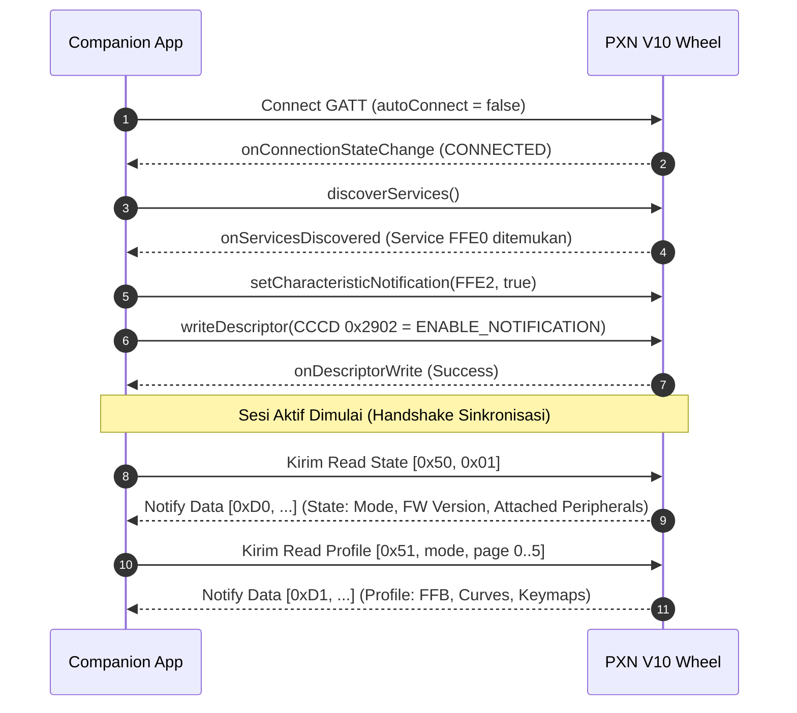
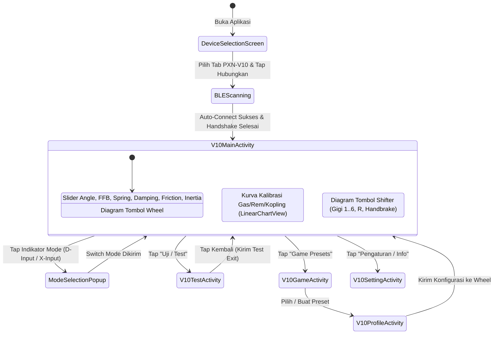

# PRODUCT REQUIREMENTS DOCUMENT (PRD)
## PXN V10 Companion Application - Architecture & Functional Specification for Rewrite

---

## 1. Executive Summary & Objective

### 1.1 Purpose
Dokumen ini merupakan **Product Requirements Document (PRD)** teknis dan fungsional yang komprehensif untuk proses *rewrite* (penulisan ulang) aplikasi Android pendamping kemudi balap **PXN V10 Force Feedback Racing Wheel**.

### 1.2 Tujuan Rewrite
1. Menyediakan acuan arsitektur dan spesifikasi biner tingkat rendah (*byte-level specification*) agar seluruh fungsionalitas asli tidak ada yang hilang atau berubah perilaku.
2. Memungkinkan migrasi ke *modern software stack* (misalnya Kotlin Modern + Jetpack Compose, Flutter, atau React Native) dengan arsitektur bersih (*Clean Architecture / MVVM / MVI*).
3. Mengeliminasi *legacy code debt* dari aplikasi lama, meningkatkan reliabilitas koneksi Bluetooth Low Energy (BLE), dan memperbaiki respon antarmuka pengguna (*UI responsiveness*).

---

## 2. Hardware Overview: PXN V10 System

Perangkat **PXN V10** adalah sistem setir kemudi balap modular berbasis Force Feedback (FFB) yang terdiri dari:
1. **Wheel Base**: Menggunakan motor penggerak Force Feedback dengan sensor sudut rotasi (hingga 900°), papan kontrol utama, dan modul Bluetooth Low Energy (BLE).
2. **Steering Rim**: Roda kemudi yang dapat dilepas (*quick release*), dilengkapi tombol aksi (A/B/X/Y, D-Pad, L1/R1, L2/R2, L3/R3, Menu, View, Home/Share) dan *magnetic paddle shifters*.
3. **Pedal Set (A3)**: 3 pedal (Gas, Rem dengan load cell / potentiometer, Kopling).
4. **Gear Shifter (A7)**: H-pattern shifter 6-kecepatan + 1 gigi mundur (Reverse), dilengkapi tombol rem tangan (*Handbrake*) dan sakelar *High/Low gear*.

Komunikasi antara aplikasi mobile dan wheel base dilakukan sepenuhnya melalui **Bluetooth Low Energy (BLE)** tanpa kabel.

```mermaid
flowchart LR
    App["Aplikasi Mobile (Companion App)"] <-->|BLE GATT (FFE0/FFE1/FFE2)| Base["PXN V10 Wheel Base"]
    Base <--> Rim["Steering Rim (Buttons & Paddles)"]
    Base <--> Pedals["Pedal Set (Gas, Brake, Clutch)"]
    Base <--> Shifter["6+1 H-Shifter & Handbrake"]
    Base <--> PC["PC / Gaming Console (USB)"]
```

---

## 3. Bluetooth Low Energy (BLE) Specification

### 3.1 Device Identification & Filtering
- **Device Local Name**: `PXN-V10`
- **Scan Filter**: Case-insensitive matching terhadap nama `result.getDevice().getName() == "PXN-V10"`.
- **Scan Settings**: Menggunakan BLE scan latency rendah untuk proses koneksi cepat.

### 3.2 GATT Profile & UUID Specification
Aplikasi berinteraksi dengan layanan custom vendor UART/Serial over BLE:

| Entity | UUID String | Deskripsi & Properti |
| :--- | :--- | :--- |
| **Primary Service** | `0000ffe0-0000-1000-8000-00805f9b34fb` | Layanan komunikasi utama PXN V10 |
| **Write Characteristic** | `0000ffe1-0000-1000-8000-00805f9b34fb` | Properti: `WRITE` / `WRITE_NO_RESPONSE`. Digunakan aplikasi untuk mengirim instruksi. |
| **Notify Characteristic** | `0000ffe2-0000-1000-8000-00805f9b34fb` | Properti: `NOTIFY`. Digunakan wheel base untuk mengirim data telemetry dan ACK. |
| **CCCD Descriptor** | `00002902-0000-1000-8000-00805f9b34fb` | Client Characteristic Configuration Descriptor (diisi `0x01, 0x00` untuk enable notify). |

### 3.3 Connection Lifecycle & Handshake Sequence



### 3.4 Rate Limiting & Write Queue Concurrency
- **Problem**: Modul BLE peripheral V10 tidak dapat menerima *burst packets* secara instan tanpa jeda pemrosesan.
- **Queue Implementation**:
  - Semua instruksi dikirim ke `Queue<byte[]>`.
  - Pacing interval minimum antar-paket tulis adalah **100 ms** (atau menunggu event callback `onCharacteristicWrite` sebelum mengambil item berikutnya).
  - Jika pengguna menggeser slider dengan cepat, aplikasi harus men-debounce atau memperbarui entri yang setipe di antrean (*packet replacement / deduplication*) agar antrean tidak membengkak.

---

## 4. Binary Communication Protocol (Packet Specification)

Komunikasi menggunakan frame biner berbasis Report ID. Byte pertama adalah **Header Opcode**, diikuti **Command/Page ID**, dan **Payload Data**.

### 4.1 Master Opcode Table

| Opcode (Hex) | Opcode (Dec) | Nama Paket | Tipe | Deskripsi |
| :---: | :---: | :--- | :---: | :--- |
| `0x50` | `80` | `REPORT_ID_READ_STATE_REQ` | Request | Meminta status runtime perangkat |
| `0xD0` | `208` | `REPORT_ID_READ_STATE_RESP` | Response | Respon status runtime perangkat |
| `0x51` | `81` | `REPORT_ID_READ_PROFILE_REQ` | Request | Membaca halaman data profile memori |
| `0xD1` | `209` | `REPORT_ID_READ_PROFILE_RESP`| Response | Respon isi data profile per halaman |
| `0x52` | `82` | `REPORT_ID_WRITE_PROFILE_REQ`| Request | Menulis seluruh halaman profile |
| `0xD2` | `210` | `REPORT_ID_WRITE_PROFILE_RESP`| Response | Konfirmasi penulisan profile |
| `0x53` | `83` | `REPORT_ID_EDIT_PARAMS_REQ` | Request | Mengubah parameter tunggal secara live |
| `0xD3` | `211` | `REPORT_ID_EDIT_PARAMS_RESP` | Response | Konfirmasi perubahan parameter tunggal |
| `0x54` | `84` | `REPORT_ID_TESTING_REQ` | Request | Menyalakan/mematikan test mode |
| `0xD4` | `212` | `REPORT_ID_TESTING_RESP` | Response | Stream telemetry real-time |

---

### 4.2 Detail Paket Request (App -> Wheel)

#### A. Read Device State
- **Ukuran**: 2 Byte
- **Struktur**: `[0x50, 0x01]`

#### B. Read Device Profile
- **Ukuran**: 3 Byte
- **Struktur**: `[0x51, (byte) mode, (byte) pageIndex]`
- **Keterangan**: `pageIndex` berjalan dari `0` sampai `5` (total 6 halaman).

#### C. Live Parameter Updates (`0x53` / `REPORT_ID_EDIT_PARAMS_REQ`)

| Sub-Command ID | Nama Fungsi | Struktur Byte | Penjelasan Parameter |
| :---: | :--- | :--- | :--- |
| `0x01` | Switch Mode | `[0x53, 0x01, mode]` | `mode`: `0x01` = D-Input, `0x02` = X-Input |
| `0x02` | Key Mapping | `[0x53, 0x02, mode, origKey, mappedKey]` | Memetakan tombol fisik `origKey` ke fungsi `mappedKey` |
| `0x03` | Force Feedback | `[0x53, 0x03, mode, ffbValue, reverse]` | `ffbValue`: 0..100 (desimal), `reverse`: `0x00` (Normal) atau `0x01` (Inverted) |
| `0x04` | Steering Angle | `[0x53, 0x04, mode, 0x01, angleL, angleH]` | `angle`: Short 16-bit Little-Endian (90°..900°). `angleL = angle & 0xFF`, `angleH = (angle >> 8) & 0xFF` |
| `0x06` | Pedal Config | `[0x53, 0x06, mode, pedalState]` | Update status pedal |
| `0x07` | Lever Config | `[0x53, 0x07, mode, leverState]` | Update status tuas transmisi |
| `0x08` | Factory Reset | `[0x53, 0x08, mode]` | Reset konfigurasi profile saat ini ke default |
| `0x09` | Physics Forces | `[0x53, 0x09, 0x01, spring, damping, friction, inertia]` | 4 Gaya Fisika (masing-masing bernilai byte `0..100`) |
| `0x0E` | Brake Handbrake | `[0x53, 0x0E, mode, brakeState]` | Update status rem tangan |

#### D. Test Mode Toggle
- **Masuk Test Mode**: `[0x54, 0x01]`
- **Keluar Test Mode**: `[0x54, 0x02]`

---

### 4.3 Detail Paket Response (Wheel -> App)

#### A. Device State Response (`0xD0` / 208)
Diterima setelah request `0x50 0x01` atau saat inisialisasi:
- `bArr[0]`: Header (`0xD0`)
- `bArr[1]`: Panjang / Status
- `bArr[2]`: **Active Mode** (`1` = D-Input, `2` = X-Input, `5` = PS4, `8` = Xbox One, `10` = Android, `11` = Switch Pro)
- `bArr[3..4]`: **Firmware Version** (16-bit Little-Endian: `minorVer = bArr[3]`, `majorVer = bArr[4]`)
- `bArr[5]`: **Pedal Connected State** (`> 0` jika terhubung)
- `bArr[6]`: **Lever (Shifter) Connected State** (`> 0` jika terhubung)
- `bArr[7]`: **Angle Mode** (`1` = Dikonfigurasi lewat app)
- `bArr[8]`: **Brake / Handbrake State** (`> 0` jika terhubung)

#### B. Profile Page Response (`0xD1` / 209)
Diterima beruntun untuk halaman `0` hingga `5`:
- `bArr[0]`: Header (`0xD1`)
- `bArr[1]`: Mode
- `bArr[2]`: **Halaman (Page Index 0..5)**
- **Page 0**: Keymap Bagian 1 (17 byte pertama tombol)
- **Page 1**: Keymap Bagian 2 (17 byte kedua tombol)
- **Page 2**:
  - `bArr[3..4]`: 2 byte tombol sisa
  - `bArr[5..6]`: **Steering Angle** (16-bit Little-Endian: `90..900`)
  - `bArr[7]`: **Force Feedback** (`0..100`)
  - `bArr[8]`: **Spring Force** (`0..100`)
  - `bArr[9]`: **Damping Force** (`0..100`)
  - `bArr[10]`: **Friction Force** (`0..100`)
  - `bArr[11]`: **Inertia Force** (`0..100`)
  - `bArr[12]`: **FFB Reverse** (`0` = Off, `1` = On)
- **Page 3 (Gas Curve)**: 4 titik koordinat x, y (masing-masing 16-bit Little-Endian short: `[x0, y0, x1, y1, x2, y2, x3, y3]`)
- **Page 4 (Brake Curve)**: 4 titik koordinat x, y (16-bit Little-Endian short)
- **Page 5 (Clutch Curve)**: 4 titik koordinat x, y (16-bit Little-Endian short)

#### C. Parameter Edit ACK (`0xD3` / 211 atau `0x53` / 83)
- `bArr[1] == 1`: Switch mode ACK -> `bArr[2]` = mode baru
- `bArr[1] == 2`: Keymap ACK -> `bArr[3]` = key, `bArr[4]` = mapped key
- `bArr[1] == 3`: FFB ACK -> `bArr[3]` = ffb, `bArr[4]` = reverse
- `bArr[1] == 4`: Angle ACK -> `bArr[4..5]` = angle short (LE)
- `bArr[1] == 9`: Force ACK -> `bArr[3]` = spring, `bArr[4]` = damping, `bArr[5]` = friction, `bArr[6]` = inertia

#### D. Live Telemetry Stream (`0xD4 0x03` / 212)
Dikirim secara kontinu saat test mode aktif:
- `bArr[2]`: Bitmask Tombol Bank 1 (`TEST_KEY_SEQUENCE_1 = [0..7]`)
- `bArr[3]`: Bitmask Tombol Bank 2 (`TEST_KEY_SEQUENCE_2 = [8..15]`)
- `bArr[4]`: Bitmask Tombol Bank 3 (`TEST_KEY_SEQUENCE_3 = [16, 17]`)
- `bArr[6]`: **Live Steering Angle Sensor** (0..255 scaled)
- `bArr[8]`: **Gas Pedal Value** (0..255)
- `bArr[9]`: **Brake Pedal Value** (0..255)
- `bArr[10]`: **Clutch Pedal Value** (0..255)
- `bArr[11]`: Shifter status
- `bArr[12]`: Bitmask Tombol Shifter/Handbrake Bank 4 (`[25, 26, 23, 24]`)
- `bArr[13]`: **Gear Position** (`1..6` = Gigi 1..6, `255` = Gigi Mundur / R, `0` = Netral)

---

## 5. Functional Requirements by Feature

### 5.1 Mode Switching: D-Input vs X-Input
- **User Story**: Sebagai pemain di PC, saya ingin mengganti mode setir antara DirectInput dan XInput tanpa mencabut kabel atau menekan kombinasi tombol fisik yang rumit.
- **Rules**:
  - Pilihan mode hanya boleh diganti jika perangkat sedang berada dalam mode PC (`mode == 1` atau `mode == 2`). Jika dalam mode konsol (PS4/Xbox), menu mode dikunci (*read-only*).
  - Pilihan mode yang tersedia di dialog:
    1. **PC DirectInput (D-Input)**: `mode = 1`
    2. **PC XInput (X-Input)**: `mode = 2`
  - Begitu dipilih, kirim paket `[0x53, 0x01, mode]`.
  - Setelah menerima konfirmasi ACK, lakukan pembacaan status ulang (`readState()`).

### 5.2 Force Feedback (FFB) & Direction Tuning
- **Parameter FFB Utama**:
  - Nilai: `0%` sampai `100%` (Step kelipatan 10).
  - Tampilan UI: Slider 0–10 (label persentase x10).
  - Kontrol Reverse: Tombol sakelar Toggle (*Normal / Reverse*).
  - Perilaku: Mengirim `writeForceFeedback(val)` saat slider dilepas (*onStopTrackingTouch*) atau di-debounce (100 ms).
- **Physics Forces Tuning**:
  - Tersedia 4 sub-parameter:
    1. **Spring Force** (Gaya pemusat setir ke tengah)
    2. **Damping Force** (Gaya berat/redaman resistansi perputaran setir)
    3. **Friction Force** (Gaya gesekan ban terhadap medan jalan)
    4. **Inertia Force** (Gaya inersia beban kemudi)
  - **Aturan Mode**: Keempat slider ini **HANYA AKTIF & DITAMPILKAN** saat wheel berada pada mode **D-Input (`1`)** atau **PS4 (`5`)**. Pada mode X-Input, DirectInput physics primitives tidak didukung hardware sehingga keempat slider ini wajib disembunyikan dari UI.

### 5.3 Steering Angle Configuration
- **Rentang Sudut**: `90°` hingga `900°`.
- **Resolusi**: Slider nilai 9–90 (dikalikan 10°).
- **Packet Generation**: Integer sudut dibagi menjadi 2 byte Little-Endian (`[0x53, 0x04, mode, 0x01, lowByte, highByte]`).

### 5.4 Pedal Response Curve Calibration
- **Tujuan**: Menyesuaikan respon kurva non-linier injakan pedal gas, rem, dan kopling sesuai kenyamanan kaki pemain.
- **Spesifikasi Koordinat**:
  - Sumbu X: Input ADC dari pedal (Rentang: `0` hingga `4095` -> 12-bit).
  - Sumbu Y: Output nilai kontrol ke game (Rentang: `0` hingga `65535` -> 16-bit).
  - Kurva dibangun dari **4 Titik Kontrol (Control Points)** dengan interpolasi kurva halus:
    - Point 0 (Default): `(0, 0)`
    - Point 1 (Default): `(1365, 21845)`
    - Point 2 (Default): `(2730, 43690)`
    - Point 3 (Default): `(4095, 65535)`
- **Preset Reset**: Tombol "Reset Curve" mengembalikan nilai ke 4 titik default di atas.
- **Penyimpanan**: Disimpan ke halaman profile 3 (Gas), 4 (Rem), dan 5 (Kopling).

### 5.5 Button Remapping System
- **Kemampuan**: Memetakan ulang tombol-tombol kemudi fisik, paddle shifter, tombol pedal, dan tuas shifter ke fungsi tombol lain atau kombinasi keyboard.
- **Urutan Keymap Sequence**:
  - Total ada 36 slot mapping yang diindeks oleh array urutan `KEYMAP_SEQUENCE`:
    `{0, 1, 2, 3, 4, 5, 6, 7, 8, 9, 10, 11, 12, 13, 17, 16, 47, 14, 15, 47, 20, 21, 22, 23, 24, 25, 26, 27, 28, 29, 30, 31, 32, 33, 34, 35}`.
- **Virtual Keyboards**:
  - Gamepad Layout Keyboard (A, B, X, Y, D-Pad, L1/R1, L2/R2, L3/R3, Menu, View, Home/Share).
  - QWERTY Letter Keyboard (Huruf A–Z).
  - Numpad & Navigation Keyboard (Angka 0–9, Tombol Panah, Enter, Esc, Shift, Ctrl, Alt, Space).
  - Opsi Reset Key (Mengembalikan ke mapping default fisik asal).

### 5.6 Real-Time Telemetry & Diagnostic (Test Screen)
- **Tujuan**: Memverifikasi kondisi fisik sensor sebelum balapan.
- **Siklus Hidup**:
  - `onStart / onResume`: Kirim `[0x54, 0x01]` (Masuk test mode). Setir mulai menyemburkan paket data `0xD4 0x03` setiap frame.
  - `onPause / onStop`: Kirim `[0x54, 0x02]` (Keluar test mode).
- **Elemen Tampilan**:
  - **Steering Gauge View**: Jarum analog / digital yang berputar mengikuti sudut setir fisik (-450° hingga +450°).
  - **Pedal Progress Bars**: 3 progress bar vertikal (Gas, Rem, Kopling) dengan rentang 0–100%.
  - **Gear Indicator**: Menampilkan angka gigi aktif (`1`, `2`, `3`, `4`, `5`, `6`, `R`, atau `N`).
  - **Button Visual Matrix**: Indikator tombol pada diagram setir yang menyala hijau saat tombol fisiknya ditekan.

### 5.7 Game Profiles & Preset Persistence
- **Model Profile Lokal (`GameProfile`)**:
  - `id`: Primary key ID
  - `name`: Nama preset (misal: "Forza Horizon 5 - Drift Setup", "F1 23 - Tight 360")
  - `mode`: Mode perangkat (1 = D-Input, 2 = X-Input, 5 = PS4, dst.)
  - `platform`: ID platform (PC, PS4, Xbox, Switch)
  - `content`: Hex String hasil serialisasi struktur data konfigurasi lengkap (versi, keymaps, angle, ffb, 4 forces, curves).
- **Format Hex String Serialisasi (`packProfile`)**:
  1. Byte Version Header: `0x03`
  2. 36 Bytes Keymap
  3. 2 Bytes Steering Angle (Little-Endian)
  4. 1 Byte FFB Value
  5. 1 Byte Spring Force
  6. 1 Byte Damping Force
  7. 1 Byte Friction Force
  8. 1 Byte Inertia Force
  9. 1 Byte FFB Reverse
  10. 16 Bytes Gas Curve (4 titik x 4 bytes)
  11. 16 Bytes Brake Curve (4 titik x 4 bytes)
  12. 16 Bytes Clutch Curve (4 titik x 4 bytes)
- **Eksekusi Pengiriman ke Wheel**:
  - Memanggil `writeProfile(page 0..5)` dengan pembagian 20-byte per frame data BLE.

---

## 6. UI / UX Specifications & Screen Flow



### 6.1 Layar Utama (`V10MainActivity`)
- **Header**:
  - Tombol Kembali.
  - Nama Perangkat ("PXN-V10") + Status Koneksi (Indikator Hijau).
  - Mode Switcher Badge (menampilkan "D-Input" atau "X-Input" dengan tanda panah dropdown jika mode PC).
  - Tombol Menu (Titik Tiga): Akses cepat ke Test Mode, Game Presets, Panduan, dan Pengaturan.
- **Tab Bar Navigasi Komponen**:
  - Tab 1: **Steering Wheel** (Pengaturan kemudi & slider gaya)
  - Tab 2: **Pedals** (Pengaturan linieritas kurva gas/rem/kopling) - *Hanya muncul jika pedal terdeteksi*
  - Tab 3: **Shifter** (Pemetaan tuas gigi) - *Hanya muncul jika shifter terdeteksi*
  - Tab 4: **Handbrake** (Status rem tangan) - *Hanya muncul jika rem tangan terdeteksi*
- **Area Slider Dinamis**:
  - List vertikal slider responsif dengan angka persentase live.
  - Tombol ikon tanda tanya (?) di samping tiap slider untuk menampilkan modal penjelasan istilah fisika (*Hint Dialog*).

---

## 7. Rekomendasi Arsitektur Rewrite Modern

Untuk penulisan ulang aplikasi yang bersih, modular, dan mudah dipelihara:

### 7.1 Layering Architecture
```
┌────────────────────────────────────────────────────────┐
│                   Presentation Layer                   │
│   (Jetpack Compose / Flutter UI / Declarative Views)   │
└───────────────────────────▲────────────────────────────┘
                            │ (StateFlow / UI State Events)
┌───────────────────────────┴────────────────────────────┐
│                      Domain Layer                      │
│   (UseCases: SwitchModeUseCase, UpdateFFBUseCase, etc)  │
└───────────────────────────▲────────────────────────────┘
                            │
┌───────────────────────────┴────────────────────────────┐
│                       Data Layer                       │
│  ┌───────────────────────┐   ┌──────────────────────┐  │
│  │   V10BleRepository    │   │  ProfileRepository   │  │
│  │ (Queue, Packets, BLE) │   │   (Room / SQLite)    │  │
│  └───────────────────────┘   └──────────────────────┘  │
└────────────────────────────────────────────────────────┘
```

### 7.2 Core Data Models (Kotlin Interface References)

```kotlin
// Model status aktif V10
data class V10DeviceState(
    val mode: V10InputMode,
    val majorVersion: Int,
    val minorVersion: Int,
    val isPedalConnected: Boolean,
    val isShifterConnected: Boolean,
    val isBrakeConnected: Boolean
)

// Enum Mode V10
enum class V10InputMode(val id: Int) {
    WAITING(0),
    PC_DINPUT(1),
    PC_XINPUT(2),
    PS4(5),
    XBOX_ONE(8),
    ANDROID(10),
    SWITCH_PRO(11);

    val isPcMode: Boolean get() = this == PC_DINPUT || this == PC_XINPUT
}

// Model Parameter Konfigurasi V10
data class V10ConfigurationProfile(
    var steeringAngle: Int = 900,        // 90..900
    var forceFeedback: Int = 100,        // 0..100
    var ffbReverse: Boolean = false,     // false = Normal, true = Inverted
    var springForce: Int = 100,          // 0..100
    var dampingForce: Int = 100,         // 0..100
    var frictionForce: Int = 100,        // 0..100
    var inertiaForce: Int = 100,         // 0..100
    val keyMappings: MutableMap<Int, Int> = mutableMapOf(),
    val accCurve: List<Point> = defaultCurve(),
    val brakeCurve: List<Point> = defaultCurve(),
    val clutchCurve: List<Point> = defaultCurve()
)

data class Point(val x: Int, val y: Int)
```

---

## 8. Checklist Verifikasi & QA (Acceptance Criteria)

Sebelum rilis hasil rewrite, lakukan checklist verifikasi fungsional berikut pada perangkat PXN V10 fisik:

- [ ] **Koneksi BLE**: Aplikasi otomatis menemukan perangkat dengan nama advert `"PXN-V10"` dan berhasil melakukan GATT discovery dalam waktu < 3 detik.
- [ ] **Mode D-Input**: Saat memilih D-Input dari menu mode, setir merespon dan di PC Windows Device Manager terdeteksi sebagai DirectInput controller.
- [ ] **Mode X-Input**: Saat memilih X-Input, Windows mendeteksi sebagai Xbox 360 / XInput Controller.
- [ ] **Visibility 4 Gaya Fisika**: Keempat slider (Spring, Damping, Friction, Inertia) otomatis muncul saat mode bernilai D-Input dan otomatis disembunyikan saat mode bernilai X-Input.
- [ ] **Slider Sudut Setir**: Menggeser sudut kemudi ke 360° secara fisik mengunci *soft lock limit* setir pada 360° (+180° ke kiri, +180° ke kanan).
- [ ] **Reverse FFB**: Membalik arah FFB mengubah gaya perlawanan setir (tidak menarik ke arah putaran).
- [ ] **Kurva Pedal**: Mengubah titik kedua kurva pedal gas langsung mengubah sensitivitas respon injakan gas di game PC.
- [ ] **Test Telemetry**: Menginjak pedal gas, rem, kopling, dan menggeser tuas gigi di test screen menghasilkan visualisasi live real-time tanpa delay (> 30 fps).
- [ ] **Factory Reset**: Menekan tombol Reset Profile mengembalikan sudut ke 900°, FFB ke 100%, kurva ke linear, dan keymap ke default pabrik.
