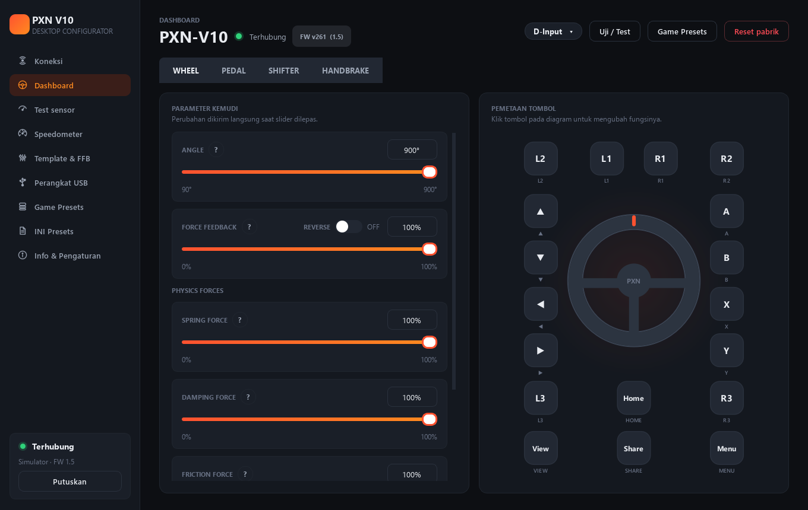

# PXN V10 Desktop

Rewrite aplikasi Android **PXN-V10** (paket `com.pxn.v10`, basecode `baseCode\app`) menjadi aplikasi **desktop Python**
(PySide6 + bleak) untuk mengonfigurasi setir PXN V10 lewat Bluetooth LE — force feedback, empat gaya fisika, sudut,
kurva pedal, pemetaan tombol, test sensor, preset game — ditambah **preset INI universal** yang bisa diedit dan dikirim
ke setir.



## Menjalankan

```powershell
cd D:\pxn\pxn_v10_desktop
python -m pip install -r requirements.txt
python run.py                # Bluetooth asli (setir PXN-V10 harus menyala)
python run.py --simulator    # setir virtual, tanpa perangkat
python -m pytest tests -q    # 142 test
```

`run.bat` melakukan hal yang sama. Data pengguna (preset, pengaturan, pustaka INI) disimpan di
`%APPDATA%\PXN-V10-Desktop\` (ubah dengan variabel lingkungan `PXN_V10_DATA_DIR`).

## Fitur

| Area | Isi | Sumber di basecode |
|---|---|---|
| Koneksi | Scan nama **PXN-V10** (case-insensitive), auto-connect, kartu perangkat + RSSI, radar, sambung cepat, sambung ulang otomatis, mode simulator | `DeviceV10Fragment`, `Wheel_V10` |
| Dashboard | Badge mode (D-Input ⇄ X-Input hanya di mode PC), tab WHEEL / PEDAL / SHIFTER / HANDBRAKE muncul sesuai hardware yang terdeteksi, reset pabrik | `V10MainActivity` |
| Parameter | ANGLE 90–900°, FORCE FEEDBACK 0–100 + REVERSE, SPRING / DAMPING / FRICTION / INERTIA (hanya D-Input & PS4), tombol `?` penjelasan | `ParamsAdapter`, `SliderItem` |
| Kurva pedal | 4 titik geser (Gas / Rem / Kopling), ADC 0–4095 → 0–65535, reset kurva | `LinearChartView` |
| Remap tombol | Diagram setir / pedal / shifter / handbrake, keyboard virtual Gamepad + Keyboard (huruf, angka, F1–F12, numpad, mouse), Reset | `*MappingView`, `*Keyboard` |
| Test | Mode uji `[54 01]/[54 02]` mengikuti halaman, gauge setir, bar pedal, gigi 1–6/R/N, matriks tombol menyala | `V10TestActivity` |
| Game Presets | Rekomendasi (asset asli + preset game dari Task 4.4) dan preset sendiri: tambah, buka/edit, simpan, ganti nama, duplikat, hapus, kirim ke setir | `V10GameActivity`, `V10ProfileActivity` |
| Info | Versi aplikasi/firmware, panduan, game didukung, log paket BLE | `V10SettingActivity` |
| **INI** | Impor INI apa pun, edit semua key, binding ke parameter setir, kirim ke setir, ekspor | fitur baru |
| **Template & FFB** | Template Drift / Race / Daily / Rally / F1 270° / Custom × Beginner / Advanced / Pro, plus FFB lanjutan (LUT, smoothing, pneumatic & mechanical trail, road / slip / kerb) yang diterjemahkan ke parameter firmware | fitur baru |
| **Perangkat USB** | Deteksi setir / shifter / handbrake sebagai USB Game Controller (hot-plug), test langsung, kalibrasi & pemetaan gigi, daftar port COM | fitur baru |
| **Koneksi USB** | Pemilih jalur Bluetooth / USB / Simulator; konfigurasi setir lewat antarmuka HID (eksperimental) | fitur baru |
| **Speedometer** | Gauge kecepatan, LED RPM, gigi, lap dari telemetri UDP game (Forza Horizon 4/5, DiRT Rally 2.0) + mode Demo | tab "Meter" (`MeterForzaActivity`, `MeterDirtActivity`) |

### Protokol (identik dengan aplikasi asli)

Service `FFE0`, tulis `FFE1`, notify `FFE2`. Paket: `50 01` (state), `51 mode page` (baca profil, 6 halaman),
`52 mode page …` (tulis profil, 6 × 20 byte), `53 …` (edit parameter: mode, keymap, FFB, sudut LE, reset, 4 gaya),
`54 01/02` (test mode), balasan `D0–D4`. Penulisan diberi jeda ≥ 100 ms dan menunggu ack (dengan timeout pengaman);
paket sejenis yang masih antre **diganti** oleh yang terbaru (slider yang digeser cepat tidak menumpuk). Hex profil
`packProfile/unpackProfile` (versi `03`, 93 byte) kompatibel, termasuk format lama big-endian dari preset bawaan.

## Preset INI

Halaman **INI Presets**: impor satu/lebih `.ini` → salinan masuk pustaka (file asli tidak diubah) → tiga tab:

1. **PARAMETER** – seluruh section/key file tampil sebagai pohon `Grup → [SECTION:SUB] → KEY = nilai`; semua nilai
   dapat diedit (klik ganda), dicari, ditambah, dihapus. Nilai `*_SETTINGS=` yang berisi **INI bersarang base64**
   (mis. `POSTPROCESSING_SCRIPT_SETTINGS`) dibuka dan diedit sebagai INI, lalu disandikan ulang.
   File yang tidak diubah ditulis kembali **byte-per-byte** sama.
2. **TERAPKAN KE SETIR** – tabel pratinjau *saat ini ↔ dari INI ↔ sumber*, peringatan parsing, lalu
   *Kirim ke setir* (menulis 6 halaman profil; jika mode preset PC berbeda, setir dialihkan D-Input ⇄ X-Input),
   *Buka di editor preset*, atau *Simpan sebagai Game Preset*.
3. **BINDING** – menghubungkan key INI mana pun ke parameter setir dengan skala linear (opsional dibalik).

## Template mode & FFB lanjutan

Halaman **Template & FFB**: pilih jenis berkendara (Drift, Race, Daily, Rally, F1 270°, Custom) dan level
(Beginner, Advanced, Pro) → 15 racikan + mode custom. Nilainya dimuat ke *draf* yang bisa diedit bebas, lalu
**Terapkan ke setir**, **Simpan preset** (masuk Game Presets lengkap dengan FFB lanjutan), atau **Ekspor INI**.
Terapkan hanya menimpa angle, FFB, reverse, dan empat gaya fisika; keymap dan kurva pedal setir dipertahankan.

Tren racikan: makin *Pro* → smoothing & damping makin kecil, FFB makin kuat, sudut makin kecil (F1 selalu 270°).
Drift butuh sudut penuh di level lanjut (720° → 900°), Rally memakai road/kerb effect tertinggi dan LUT anti-clipping,
Daily paling lembut dan stabil. **Ini titik awal racikan berdasarkan praktik umum sim racing — bukan data pabrikan PXN
dan belum diuji pada setir fisik.**

**FFB lanjutan dan keterbatasan firmware.** Firmware V10 hanya memahami FFB, Spring, Damping, Friction, Inertia, Angle
dan Reverse. LUT, smoothing, trail dan efek road/slip/kerb adalah pemrosesan tingkat game/driver, jadi *tidak dapat
dikirim apa adanya*. `core/ffb_advanced.py` menerjemahkannya dengan rumus terbuka (kolom **Hasil ke setir** menampilkan
kontribusi tiap parameter):

| Parameter lanjutan | Dikirim ke firmware sebagai |
|---|---|
| LUT | FFB × luas kurva LUT (1.0 = linear); LUT juga disimpan di preset/INI |
| Smoothing | + Damping (0.35×) dan + Inertia (0.10×) |
| Pneumatic trail (50 = netral) | Spring ± 0.40 × (nilai − 50) |
| Mechanical trail (50 = netral) | Inertia ± 0.40 × (nilai − 50), Damping ± 0.15 × (nilai − 50) |
| Road effect | + Friction (0.30×) — keterangan Friction di app asli: "detail permukaan jalan" |
| Kerb effect | + Friction (0.20×) |
| Slip effect | + Friction (0.15×), − Damping (0.10×) |

Hasilnya *perkiraan*: bukan filter sinyal yang berjalan di dalam setir (itu butuh jalur FFB lewat driver/PC).
Di mode X-Input (tanpa gaya fisika) hanya FFB yang disesuaikan, sisanya hanya disimpan. Koefisien ada di
`COEFFICIENTS` dan mudah disetel.

### Menyesuaikan template

Setiap template dan level bisa disesuaikan: semua slider (angle, FFB, empat gaya, reverse, LUT, smoothing, trail,
efek) dapat diubah, dan perubahan **tersimpan otomatis per template dan level** (`template_overrides` di setelan),
jadi berpindah template atau menutup aplikasi tidak menghilangkannya. Template yang diubah diberi penanda
**DIMODIFIKASI**; tombol **Reset ke bawaan template** menghapus penyesuaiannya. Mode **Custom** menyimpan setelannya
sendiri. Mengembalikan semua nilai ke bawaan juga menghapus penandanya.

## Speedometer

Halaman **Speedometer** meniru tab "Meter" pada aplikasi asli: game mengirim telemetri UDP ke `IP:Port` komputer ini
(port bawaan **9000**, seperti `Constants.TELEMETRY_PORT`). Format paket dibaca dengan offset yang sama dengan aplikasi
Android: Forza Horizon 4/5 (paket "Dash" 324 byte) dan DiRT Rally 2.0 (UDP lama `extradata=3`, 264 byte); mode **AUTO**
memilih game dari panjang paket. Tersedia satuan km/h atau mph, skala otomatis atau tetap, LED RPM, gigi, lap, waktu
lap dan lap terbaik, serta mode **Demo** tanpa game.

**Penting:** data kecepatan **berasal dari game, bukan dari setir**. Firmware V10 tidak punya sensor kecepatan atau
jalur untuk menerimanya (lihat `fw_analysis/LAPORAN.md`), jadi speedometer hanya bekerja bila game mengirim telemetri.
Dashboard pada baseCode (`com.pxn.v12`) adalah fitur perangkat PXN V12 lewat SimRace Tool, bukan V10. Parser diuji
dengan paket buatan sendiri dan soket UDP lokal; **belum diuji dengan game sungguhan**. Petunjuk pengaturan di halaman
(Data Out Forza, `hardware_settings_config.xml` DiRT) adalah panduan umum, periksa menu game Anda.

## Perangkat USB (setir, shifter, handbrake)

Halaman **Perangkat USB** membaca perangkat yang terpasang sebagai *USB Game Controller* langsung dari deskriptor
HID (`usb/hid_joystick.py`, `HidP_GetUsageValue`, hanya-baca, tanpa driver atau pustaka tambahan), dengan `winmm`
sebagai cadangan untuk perangkat non-HID, dan memindai ulang otomatis (hot-plug). Pembacaan lewat deskriptor dipakai
karena `winmm` terbukti salah pada perangkat nyata: ia hanya mengenal 6 sumbu standar, salah menguraikan sumbu 10-bit
yang tidak sejajar byte (handbrake) dan tidak mengekspos sumbu Rx/Ry/Slider/Simulation (setir PXN-V10 punya 7 sumbu). Peran ditebak dari nama/jumlah sumbu & tombol dan bisa diganti:
Setir, Pedal, Shifter, Handbrake, Lainnya.

* **TEST**: setir (gauge + pedal), shifter (diagram H-pattern + gigi aktif), handbrake (bar + status ditarik),
  sumbu mentah, dan lampu tombol.
* **KONFIGURASI** (tersimpan otomatis di PC): kalibrasi sumbu (deteksi otomatis dengan menggerakkan kontrol, set
  min/maks, balik, zona mati/jenuh, gamma), pemetaan gigi H-pattern lewat "Pelajari", shifter sekuensial
  (naik/turun/hat switch), handbrake analog atau tombol dengan ambang aktif.
* **Port COM** terdaftar ditampilkan (mis. shifter/handbrake DIY Arduino), tetapi datanya tidak dibaca: protokol serial
  perangkat DIY berbeda-beda dan tidak diketahui aplikasi.

Konfigurasi di atas adalah kalibrasi *sisi aplikasi*; tidak ditulis ke firmware shifter/handbrake.

### Konfigurasi setir lewat USB (eksperimental)

Halaman **Koneksi** punya pemilih jalur **Bluetooth / USB / Simulator**. Dokumentasi PXN V10 yang tersedia tidak
menjelaskan protokol konfigurasi USB, jadi `usb/hid_transport.py` mengasumsikan firmware menerima frame `50..54` yang sama
lewat antarmuka HID *vendor-defined* (Usage Page ≥ 0xFF00) yang punya report input dan output. Pengamanannya:

* hanya antarmuka yang memenuhi syarat itu yang ditawarkan, dan tidak pernah tersambung otomatis;
* saat menyambung hanya SATU permintaan baca (`50 01`) dikirim; tanpa balasan `D0` koneksi dibatalkan dan tidak ada
  perintah tulis yang pernah keluar; perintah tulis juga ditolak di level transport sampai balasan pertama diterima;
* bila tidak ada antarmuka seperti itu, aplikasi menjelaskannya dan konfigurasi firmware tetap lewat Bluetooth.

### Format native `[PXN_V10:*]`

```ini
[PXN_V10:GENERAL]   NAME=…  MODE=1  PLATFORM=1
[PXN_V10:WHEEL]     ANGLE=900  FFB=80  FFB_REVERSE=0  SPRING=70  DAMPING=60  FRICTION=50  INERTIA=50
[PXN_V10:CURVE_ACC] P0=0,0  P1=1365,21845  P2=2730,43690  P3=4095,65535   (juga CURVE_BRAKE / CURVE_CLUTCH)
[PXN_V10:KEYMAP]    L1=R1  R1=L1  …
[PXN_V10:FFB_ADV]   ENABLED=1  LUT=0,25,50,75,100  SMOOTHING=20  PNEUMATIC_TRAIL=60  MECHANICAL_TRAIL=55
                    ROAD=30  SLIP=40  KERB=25   (diterjemahkan ke parameter firmware saat dikirim)
```

Bagian yang tidak ditulis tidak mengubah parameter itu di setir. Nilai di luar rentang dibatasi dan dilaporkan; kurva
yang tidak menaik diperbaiki. Binding diproses setelah bagian native (binding menang bila keduanya ada).
Contoh: [`presets/PXN V10 contoh (native).ini`](presets/PXN%20V10%20contoh%20(native).ini). Semua section lain
dalam file dipertahankan, sehingga satu file bisa memuat konfigurasi game **dan** setir.

> **Catatan penting tentang `shader PXN V10 Ai 4 (Drift)).ini`.** File itu adalah konfigurasi
> **Assetto Corsa – Custom Shaders Patch** (63 section, 121 key: `FFB_TWEAKS`, `EXTRA_FX`, `GRAPHICS_ADJUSTMENTS`, …).
> Ia **tidak memuat parameter yang dimengerti firmware PXN V10** (firmware hanya punya mode, keymap, FFB + reverse,
> sudut, 4 gaya, 3 kurva). Karena itu seluruh isinya bisa diimpor, diedit, dan diekspor, tetapi untuk *mengirimnya ke
> setir* perlu bagian `[PXN_V10:*]` (tombol "Tambahkan bagian PXN_V10") atau binding, misalnya
> `FFB_TWEAKS:CUSTOM_SOFT_LOCK / DAMPER` (0–0.1) → Damping (0–100 %). Binding itu keputusan Anda; aplikasi tidak
> menebak padanan antar-game.

## Arsitektur

```
pxn_v10/
  core/      constants, keycodes, models (DeviceState/DeviceProfile/TestData), codec, hexprofile,
             write_queue (jeda + penggantian paket), events,
             ffb_advanced (LUT/filter/trail/efek → parameter firmware), templates (15 racikan)  ← murni Python
  usb/       hid (enumerasi HID via ctypes) · joystick (winmm + simulasi) · config (kalibrasi, shifter, handbrake,
             wizard deteksi) · devices (pemindai + monitor hot-plug + port COM) · hid_transport (konfigurasi USB)
  ble/       transport (abstraksi) · bleak_transport (BLE asli) · mock_device/mock_transport (simulator)
             client.WheelClient: FSM koneksi, antrean tulis 100 ms, router paket, auto-reconnect
  ini/       document (parser universal) · schema · mapper (INI ⇄ profil, binding, pratinjau diff)
  storage/   database (SQLite GameProfile + preset rekomendasi) · settings · paths
  ui/        theme · widgets (slider, kurva, LUT, diagram tombol, gauge, instrumen USB, key picker, pohon INI) · pages
tests/       protokol, client⇄simulator, INI, UI headless
tools/       screenshots.py, shot_real_like.py (render halaman ke PNG untuk review)
```

Lapisan `core`/`ble` tidak mengimpor Qt, sehingga bisa dipakai ulang untuk model PXN lain (Task 7.1). Asyncio
berjalan di thread sendiri (wajib agar bleak/WinRT bekerja bersama Qt di Windows); UI menerima event lewat signal.

## Status verifikasi (jujur)

* **142 test otomatis lulus**: byte-level codec, hex profil, antrean, seluruh alur `WheelClient` ⇄ simulator
  (handshake, tulis parameter, pacing, dedup, mode switch, tulis profil, reset, kurva, test mode, link-loss,
  reconnect), parser INI (termasuk round-trip file shader asli), mapper/binding, dan alur UI headless.
* **Fitur USB & template — yang terbukti**: enumerasi HID dan `winmm` dijalankan pada PC pengembang (19 antarmuka HID
  terbaca lengkap dengan VID:PID/Usage Page; `winmm` termuat; daftar COM terbaca). Logika kalibrasi, decoder shifter,
  wizard, pemindai/hot-plug, transport HID (lawan setir virtual, termasuk perangkat yang diam, dicabut, dan tolak-tulis
  sebelum terverifikasi), terjemahan FFB, template, INI, dan database (termasuk migrasi) diuji otomatis.
* **Fitur USB & template — yang BELUM terbukti**: tidak ada setir/shifter/handbrake USB yang terpasang saat
  pengembangan, jadi pembacaan `joyGetPosEx` pada perangkat nyata dan I/O HID (`WinHidIO`, overlapped) hanya teruji
  lewat simulasi. Protokol konfigurasi USB firmware V10 adalah asumsi (lihat di atas). Nilai racikan template dan
  koefisien terjemahan FFB belum diuji pada setir fisik.
* **Diuji pada perangkat fisik (hanya-baca)**: scan, koneksi GATT FFE0/FFE1/FFE2, `50 01`, dan 6 halaman `51`.
  Hasilnya cocok dengan PRD (kurva Gas default persis `(0,0) (1365,21845) (2730,43690) (4095,65535)`,
  keymap identitas, sudut/FFB/gaya terbaca benar). Firmware yang diuji melapor `angle_mode = 0`, sehingga slider
  ANGLE disembunyikan — sama seperti aplikasi asli; kurva Rem/Kopling bernilai nol (UI memberi catatan + Reset kurva).
* **Belum diuji pada perangkat fisik**: semua perintah *tulis* (sudut, FFB, gaya, keymap, kurva, tulis profil, ganti
  mode, reset pabrik, test mode). Jalur-jalurnya identik dengan basecode dan lulus terhadap simulator, tetapi saya
  sengaja tidak mengubah setelan setir Anda tanpa izin. Jalankan checklist PRD §8 pada setir Anda sebelum
  mengandalkannya.

## Perbedaan dengan aplikasi Android (disengaja)

* Model lokal diperbarui langsung saat menulis (tidak menunggu ack) sehingga dua slider yang digeser berurutan tidak
  saling menimpa; ack tetap menjadi sumber kebenaran akhir.
* Timeout ack 400 ms agar antrean tidak macet bila satu balasan hilang (aslinya berhenti selamanya).
* Kotak angka untuk nilai tepat di samping tiap slider (preset legacy punya nilai seperti 75 yang bukan kelipatan 10).
* Preset *rekomendasi* memakai `preset_en.json` bawaan + 5 preset game dari Task 4.4 secara offline.
  **Tidak diport**: sinkronisasi/unggah config ke server pabrikan, cek firmware online, video tutorial, izin
  Android/lokasi, haptik.
* Baris huruf pada keyboard virtual: Tab kedua (duplikat di sumber) diganti Backspace.
